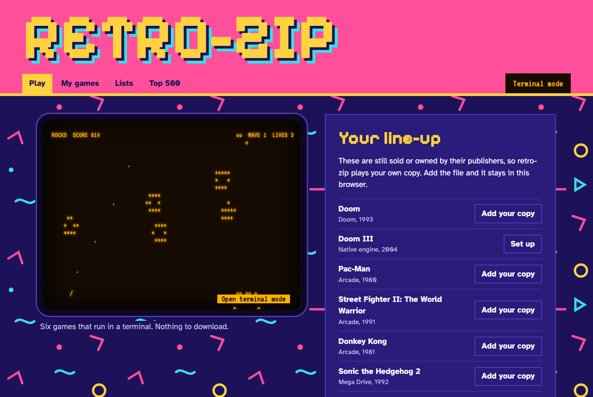
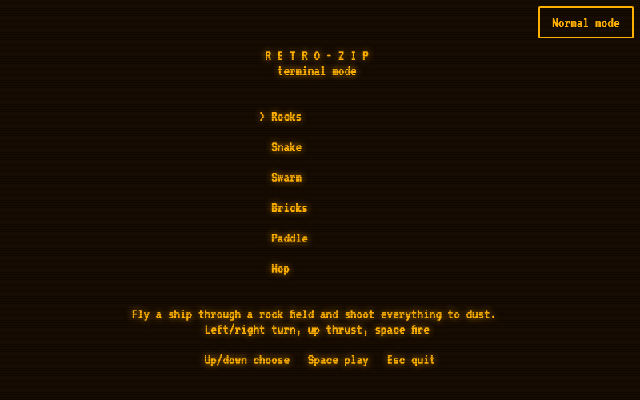

# retro-zip

A retro game library with two modes. Normal mode runs emulated games in the browser. Terminal mode plays six original games in a real terminal or on a CRT-style screen.



<!-- run-steps:start -->
## Run it locally, step by step

1. **Install [Node.js](https://nodejs.org) 22** or newer.

2. **Get the code:**

   ```sh
   git clone https://github.com/Gitguy268/retro-zip.git
   cd retro-zip
   ```

3. **Install and download the emulator files** (about 310 MB, of which about 85 MB is kept):

   ```sh
   npm install
   npm run vendor
   ```

4. **Start it:**

   ```sh
   npm start
   ```

   On a Mac you can double-click `start.command` instead of these two steps.

5. **Open <http://127.0.0.1:8642/>** in your browser. Press `Ctrl+C` in the terminal to stop.
<!-- run-steps:end -->

## What you can play

| | Where it comes from | Download |
|---|---|---|
| Rocks, Snake, Swarm, Bricks, Paddle, Hop | Built in | None |
| Doom shareware episode | Built into the Doom engine | None |
| Homebrew and free arcade games (36 titles, including Freedoom) | Each author's permitted source | Under 8 MB starts straight away; larger files ask first |
| Your own files, including the Top 500 | Your copies | None, they stay in your browser |

**retro-zip doesn't download commercial games.** Pac-Man, Street Fighter II, Donkey Kong, Sonic the Hedgehog 2, Streets of Rage 2, Doom III and the rest of the Top 500 are listed so you can add your own copy.

## Start

On a Mac, double-click `start.command`. The first run downloads about 310 MB and keeps about 85 MB. Needs [Node.js](https://nodejs.org) 20 or newer.

```sh
npm install && npm run vendor && npm start   # then open http://127.0.0.1:8642
```

Terminal mode, from the repo folder:

```sh
node bin/retro-zip.mjs              # menu
node bin/retro-zip.mjs play rocks   # one game
node bin/retro-zip.mjs list
```

Add `bin/` to your PATH, or run `npm link`, to use plain `retro-zip`. The window must be at least 80x24.



<details>
<summary>File formats</summary>

| Files | What happens |
|---|---|
| `.nes .sfc .smc .gb .gbc .gba .md .gen .smd .sms .gg .a26 .a78 .lnx .pce .col .ngp .ws .32x` | Plays on the matching system |
| `.bin .rom .iso .chd` | Identified from the contents where possible; otherwise you pick the system |
| `.cue .pbp` | PlayStation. A `.cue` needs its `.bin` tracks, so `.chd` or `.pbp` is simpler |
| `.zip` | One file inside: unpacked. Several: treated as an arcade ROM set |
| `.wad` | Doom engine |
| `.state` | Attaches to a game you choose, and only works with the emulator that made it |
| `.rvz .gcm .wbfs` | Refused. GameCube and Wii can't run at a playable speed in a browser |

PlayStation games may need BIOS files that aren't included. Arcade sets must match the emulator's expected version; switch between FBNeo and MAME 2003-Plus in My games.
</details>

<details>
<summary>Doom III</summary>

Doom III runs as a native Mac app through [dhewm3](https://github.com/dhewm/dhewm3) with your own Steam or GOG game files. Run `scripts/build-dhewm3.sh` once (it needs Xcode's command line tools, CMake and Homebrew, and installs SDL2 and OpenAL), then choose your game folder on the Doom III page.
</details>

<details>
<summary>Limits</summary>

- The browser Doom engine has no sound.
- Nintendo 64, Saturn, DS, Dreamcast, PSP and PlayStation 2 aren't supported.
- The Top 500 is an editorial list, not an official chart.
- Your library lives in one browser's storage. Clearing site data deletes it.
- Several emulator cores restrict commercial use, so retro-zip must not be sold. See [NOTICE](NOTICE).
</details>

## Security

Nothing can promise 100% safety, particularly for files from elsewhere. Only add files from sources you trust. This is what retro-zip enforces:

**Catalogue downloads**
- The server accepts a catalogue ID, never an address.
- HTTPS only, with an approved host list applied to every redirect.
- Exact size enforced during transfer, SHA-256 checked, and file type checked. Any failure discards the file.

**Running games**
- Games run in a sandboxed iframe with no origin. They can't reach your library, browser storage, the local API or other websites.
- The emulators need `unsafe-eval`, so that permission exists only inside this sandbox.
- Zip files are unpacked in memory with caps on file count and size, and a file that expands past its declared size is stopped.
- Program files are refused.

**Local server**
- Listens on 127.0.0.1 only.
- Rejects API requests from other websites and hostnames, and blocks path traversal.
- Emulator and Doom engine downloads are pinned to exact versions and hashes.

Report a problem: [SECURITY.md](SECURITY.md).

## Development

`npm test` runs the unit tests. See [CONTRIBUTING.md](CONTRIBUTING.md) for browser tests and for adding games.

## Licence

GPL-3.0. See [LICENSE](LICENSE) and [NOTICE](NOTICE). Not affiliated with any game publisher.
